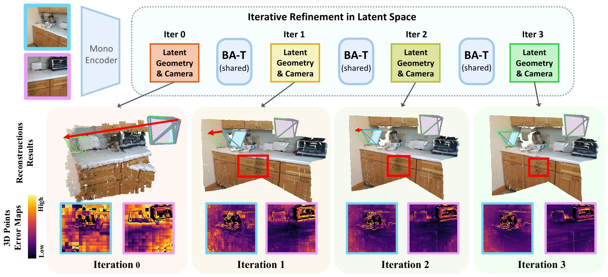

<!-- PROJECT LOGO -->
<p align="center">
  
</p>
<h1 align="center">
  BA-T: An Iterative Transformer for Two-View Bundle Adjustment
</h1>

<p align="center">
  <a href="https://ganlinzhang.xyz" target="_blank"><strong>Ganlin Zhang<sup>1,2</sup></strong></a>
  ·
  <a href="https://wrchen530.github.io/" target="_blank"><strong>Weirong Chen<sup>1,2</sup></strong></a>
  ·
  <a href="https://cvg.cit.tum.de/members/cremers" target="_blank"><strong>Daniel Cremers<sup>1,2</sup></strong></a>
  ·
  <a href="https://xiwang1212.github.io/homepage/" target="_blank"><strong>Xi Wang<sup>1,2,3</sup></strong></a>
</p>
<p align="center">
  <strong><sup>1 </sup>TU Munich, <sup>2 </sup>MCML, <sup>3 </sup>ETH Zurich</strong>
</p>
<h3 align="center">NeurIPS 2026</h3>
<h4 align="center">
  <a href="https://arxiv.org/abs/2606.03287" target="_blank">arXiv</a>
  |
  <a href="https://zhangganlin.github.io/BA-T/" target="_blank">Project Page</a>
</h4>

<p align="center">
  
</p>
<p align="center">
  <b>TL;DR:</b> BA-T is a repeatable, compact Transformer layer that refines camera pose and local geometry in latent space, inspired by bundle adjustment.
</p>

---

This repository contains the inference code and pretrained model of BA-T. Given
an image **A** and one or more images **B**, the model predicts, for every
(A, B) pair:

- a dense 3D point map (with confidence) for each of the two images, in that
  image's own camera frame;
- the relative camera pose between the two images, in both directions.

Both images are encoded by a shared ViT-L encoder. A single shared BA-T layer
then refines the pair's tokens and a relative camera token recursively. You
choose the number of iterations `K` at test time.

The same model also refines more than two views jointly on a view graph. This
is an extension of the two-view setting; see [Multi-view extension](#multi-view-extension).

## Installation

Tested with Python 3.11, PyTorch 2.5.1 and CUDA 12.1 on Linux.

```bash
git clone https://github.com/zhangganlin/BA-T.git && cd BA-T
conda create -n bat python=3.11 -y && conda activate bat

# 1. PyTorch (pick the index that matches your CUDA driver)
pip install torch==2.5.1 torchvision==0.20.1 --index-url https://download.pytorch.org/whl/cu121
# optional: xformers memory-efficient attention (must match the torch version)
pip install xformers==0.0.28.post3 --index-url https://download.pytorch.org/whl/cu121

# 2. Python dependencies (numpy, pillow; open3d to view the demo's point clouds)
pip install -r requirements.txt

# 3. (recommended) CUDA kernel for RoPE. It needs nvcc matching torch's CUDA version;
#    without a system CUDA toolkit, install one into the env first:
#    conda install -c nvidia/label/cuda-12.1.1 cuda-nvcc cuda-cudart-dev -y
cd ba_t/models/pos_embed/curope && pip install --no-build-isolation . && cd -
```

- **curope** is optional. Without it, a PyTorch RoPE implementation is used
  and a warning is printed at import time; results differ by float rounding
  only. The kernel is compiled for sm_75 to sm_90 (T4, RTX 20/30/40 series,
  A100, L4/L40S, H100), plus PTX. To target another GPU, add a `-gencode`
  entry to `ba_t/models/pos_embed/curope/setup.py`.
- **xformers** is optional. Without it, `torch.nn.functional.scaled_dot_product_attention`
  is used.
- The model also runs on the CPU (slowly). With curope and xformers on an RTX
  4070, one pair takes about 50 ms at `K=8`, using 1.3 GB of GPU memory.

## Pretrained model

Two checkpoints are available on the [Hugging Face model page](https://huggingface.co/zhangganlin/BA-T)
(1.4 GB each). Put them in `pretrains/`:

| checkpoint | description |
| --- | --- |
| [bat.pth](https://huggingface.co/zhangganlin/BA-T/resolve/main/bat.pth) | Default. The paper model, further fine-tuned with more refinement iterations and on multi-view graphs. |
| [bat_paper.pth](https://huggingface.co/zhangganlin/BA-T/resolve/main/bat_paper.pth) | The checkpoint used for the results in the paper (two-view). |

Both have the same architecture and work with all scripts; select one with
`--ckpt` (default `pretrains/bat.pth`) or `load_model(...)`.

## Quick start

```bash
python demo.py --images path/to/A.jpg path/to/B.jpg --output outputs/demo
# or a folder containing exactly two images (natural sort order: the first one is A)
python demo.py --images path/to/folder --output outputs/demo
```

The demo prints the relative pose and writes:

| file | content |
| --- | --- |
| `prediction.npz` | `pts3d_a`, `pts3d_b` (224x224x3); `conf_a`, `conf_b`; `T_b_from_a`, `T_a_from_b` (4x4); the 224x224 input images `img_a`, `img_b`; and the source paths `path_a`, `path_b` |
| `pointcloud.ply` | coloured point cloud of both images in the camera frame of A, keeping points with confidence > `--conf_thresh` |

Options: `--num_refine_iter` (K, default 8), `--ckpt` (default `pretrains/bat.pth`),
`--conf_thresh` (default 3.0) and `--device`; see `python demo.py --help`.
To view the point cloud:

```bash
python -c "import open3d as o3d; o3d.visualization.draw_geometries([o3d.io.read_point_cloud('outputs/demo/pointcloud.ply')])"
```

### Python API

```python
from ba_t.data import load_views
from ba_t.inference import load_model, run_pairs

model = load_model('pretrains/bat.pth', device='cuda')
view_a, view_b = load_views(['A.jpg', 'B.jpg'])
out = run_pairs(model, view_a, [view_b], num_refine_iter=8)

T_b_a = out['a'][0]['relative_pose']   # (1,4,4) camera A -> camera B
T_a_b = out['b'][0]['relative_pose']   # (1,4,4) camera B -> camera A
pts_a = out['a'][0]['pts3d']           # (1,224,224,3) in the camera frame of A
pts_b = out['b'][0]['pts3d']           # (1,224,224,3) in the camera frame of B
conf_b = out['b'][0]['conf']           # (1,224,224), >= 1
```

`run_pairs` also accepts several images B: `run_pairs(model, view_a, [view_b1,
view_b2, ...])` runs every pair (A, B_i) independently, encodes A only once, and
returns entry `i` of `out['a']` / `out['b']` for pair i.

To get the predictions of every iteration `1..K`, pass `all_iters=True`. This
returns a list of `K` such dicts. The refinement is causal, so entry `k`
equals a run with `num_refine_iter=k+1`.

### Output conventions

- Cameras follow OpenCV: x right, y down, z forward. Each point map is
  expressed in its own view's camera frame.
- `out['a'][i]['relative_pose']` is `T_B<-A`. It maps camera-A points into
  camera B, i.e. `inv(c2w_B) @ c2w_A`. `out['b'][i]['relative_pose']` is the
  inverse direction. The two
  predictions are made separately, so they are only approximately inverse to
  each other.
- Scale: within one pair, the point maps and the pose translation share one
  arbitrary scale. That scale is not metric and differs between pairs.
- `conf` (point confidence) is >= 1, where higher is better.
- Number of iterations: the default is `K=8`. Set it with `--num_refine_iter` or
  `num_refine_iter`. The model was trained with 4 to 24 iterations.

## Multi-view extension

BA-T's layer is not limited to one pair. Given V views and a view graph (edges
between covisible views), every view cross-attends to all its neighbours, and
every edge has its own relative camera token. All views and edges are refined
jointly by the same layer; two views are simply the graph `[(0, 1)]`. The
released model was trained on graphs of 2 to 8 views, and the same weights are
used for two-view and multi-view inference.

```bash
python demo_multiview.py --images path/to/folder --output outputs/demo_mv
# explicit view graph (view indices in natural sort order) instead of the automatic one
python demo_multiview.py --images path/to/folder --graph 0-1 1-2 2-3 0-3
```

By default, `demo_multiview.py` / `ba_t.inference.run_multiview` do the following:

1. **Build the view graph from the encoder features** (`ba_t/graph.py`). The
   similarity of two views is the fraction of mutual nearest-neighbour patches
   of their encoder tokens. Pairs with similarity >= `--sim_thresh` (0.3) are
   connected, with at most `--max_neighbors` (7) neighbours per view. A maximum
   spanning tree of the similarities is always added, so all views form one
   connected component.
2. **Refine all views jointly** on that graph for `K` iterations. This gives a
   point map per view and both relative poses `T_j<-i` / `T_i<-j` per edge.
3. **Optimize the pose graph** (`ba_t/pose_graph.py`), guided by the
   predicted pose confidence of every edge:
   - Edges whose confidence is below `--min_rel_conf` (0.5) times the graph's
     median are not used for the camera poses. A maximum-confidence spanning
     tree is always kept, so all views stay connected.
   - Camera poses are initialized by chaining the relative poses along that
     tree.
   - The poses are then refined jointly against every kept edge, in both
     directions, with a robust loss weighted by the squared confidence.

   Pass `--no_pgo` / `optimize_poses=False` to keep the spanning-tree poses.

| file | content |
| --- | --- |
| `prediction.npz` | `pts3d` (V,224,224,3) and `conf` (V,224,224), each view in its own camera frame; `cam_to_world` (V,4,4) camera poses in the camera frame of view 0; `graph` (E,2) and the per-edge `pose_ij` (`T_j<-i`) and `pose_ji` (`T_i<-j`); `pose_edges`, the indices of the edges used for the camera poses; `similarity` (V,V); the input images `imgs` and `paths` |
| `pointcloud.ply` | coloured point cloud of all views in the camera frame of view 0 |

```python
from ba_t.data import load_views
from ba_t.inference import load_model, run_multiview

model = load_model('pretrains/bat.pth', device='cuda')
views = load_views('path/to/folder')         # V images, natural sort order
out = run_multiview(model, views)            # graph=None: automatic view graph

out['graph']          # [(i, j), ...] edges of the view graph
out['cam_to_world']   # (V,4,4) camera poses after pose graph optimization
out['pts3d']          # (V,224,224,3) point maps, each in its own camera frame
```

Point maps and translations share one arbitrary scale across all views. With
curope and xformers on an RTX 4070 at `K=8`, 8 views take 0.4 s and 1.6 GB of
GPU memory, and 64 views take 3 s and 3.3 GB. Graphs larger than 8 views go
beyond the training setting; the neighbour limit keeps each view's
neighbourhood within it.

## Repository layout

```
demo.py                       two-view example (images -> pose, point maps, .ply)
demo_multiview.py             multi-view example (view graph, joint refinement, pose graph optimization)
ba_t/
  data.py                     image loading and preprocessing
  inference.py                load_model(), run_pairs(), run_multiview()
  graph.py                    view graph from encoder-feature similarity
  pose_graph.py               confidence-based edge selection, spanning-tree initialization, pose graph optimization
  models/
    bat_model.py              BAT model: encoder, recursive BA layer on a view graph, heads
    blocks/ba_blocks.py       BundleAdjustmentLayer and its building blocks
    blocks/vit_blocks.py      ViT blocks, (xformers) attention, patch embedding
    heads/                    linear point-map head, pose head
    pos_embed/                RoPE2D (+ curope CUDA kernel)
  utils/                      cropping, image normalization
media/                        README images
pretrains/                    put bat.pth here
```

## Acknowledgement

This code builds on [ViSTA-SLAM](https://ganlinzhang.xyz/vista-slam/) and
[DUSt3R](https://github.com/naver/dust3r).

## License

The code is released under the Apache License 2.0, except for the files derived
from Naver code (marked by their file headers), which are licensed under
CC BY-NC-SA 4.0. See [LICENSE](LICENSE) for details.

## Citation

If you find our work useful, please consider citing:

```bibtex
@inproceedings{zhang2026bat,
  title     = {{BA-T}: An Iterative Transformer for Two-View Bundle Adjustment},
  author    = {Zhang, Ganlin and Chen, Weirong and Cremers, Daniel and Wang, Xi},
  booktitle = {Advances in Neural Information Processing Systems (NeurIPS)},
  year      = {2026}
}
```
